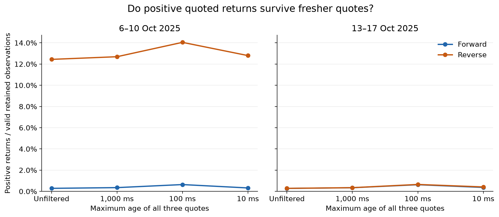
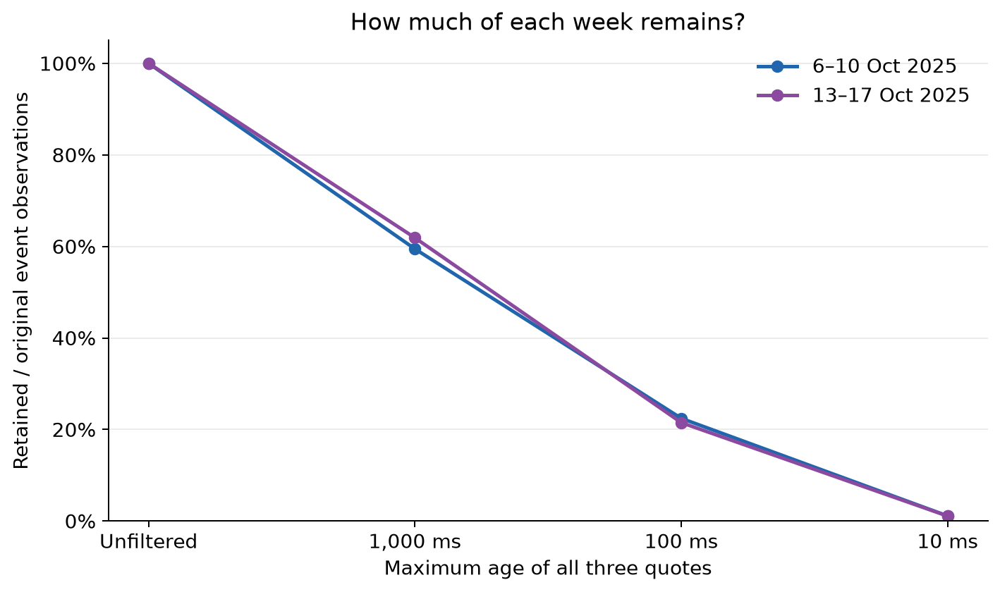

# Triangular FX arbitrage and quote freshness

An exploratory study of apparent triangular arbitrage in EUR/USD, USD/JPY and EUR/JPY tick quotes. It compares two trading weeks and asks whether positive quoted returns persist when all three quotes must be recent.

**Read the [final analysis notebook](notebooks/final_analysis.ipynb)** for the methodology, executed code, tables, charts and conclusions. Saved outputs can be read without running the notebook.

## Main findings

The samples cover **6–10 October 2025** and **13–17 October 2025**, in UTC.

| Week | Forward positive share, unfiltered | Reverse positive share, unfiltered | Reverse positive share, 10 ms limit |
|---|---:|---:|---:|
| 6–10 October | 0.286% | 12.443% | 12.800% |
| 13–17 October | 0.280% | 0.286% | 0.418% |

The original week's directional asymmetry is not reproduced in the following week. Requiring fresher quotes does not consistently reduce positive shares or resolve that asymmetry. The strictest filter retains only about **1.1%** of observations in either week.

**These are positive quoted returns, not demonstrated executable profits.** The cause of the first week's anomaly remains unexplained.



## Method

Tick quotes were downloaded from Dukascopy using `dukascopy_python`. The pipeline aligns the three pairs on the union of their event timestamps, carrying forward the latest available quote for each pair. Analysis starts once all three pairs have quotes.

It calculates returns for two cycles using the appropriate bid and ask prices:

- **Forward — EUR → USD → JPY → EUR:** `(bid_EURUSD × bid_USDJPY) / ask_EURJPY − 1`
- **Reverse — EUR → JPY → USD → EUR:** `bid_EURJPY / (ask_EURUSD × ask_USDJPY) − 1`

Four conditions are compared: unfiltered, and maximum quote ages of **1,000 ms, 100 ms and 10 ms**. All three pairs must meet the age limit. Age measures time since the latest quote update, not time since a price last changed.

**Positive share** uses valid retained returns as its denominator. **Retained share** measures how much of the original event sample passes the filter. Excluded rows remain missing so positive episodes are not joined across filtered intervals.



## Interpretation and limits

This is a descriptive comparison, not a trading backtest. Quoted bid–ask spreads are included, but commissions, latency, slippage, sequential execution risk and tradable capacity are not modelled.

The shares are event-weighted rather than time-weighted. Consecutive observations are not independent opportunities, and stricter filters select different subsets of market events. Differences between thresholds do not establish a causal effect of staleness.

Two weeks do not establish long-term prevalence. The analysis does not identify the cause or daily concentration of the original anomaly, and freshness filtering does not constitute a complete validation of the raw data. The notebook documents these limitations alongside the results.

## Reproduce the analysis

Use Python 3.12. From the repository root, create an environment and install the project plus the notebook dependencies:

```bash
python3.12 -m venv .venv
source .venv/bin/activate
python -m pip install -e . matplotlib pyarrow jupyterlab
python -m jupyterlab notebooks/final_analysis.ipynb
```

Select the environment's Python kernel and run all cells. The notebook runs from either the repository root or `notebooks/`; it does not depend on any exploratory notebook or download data during execution.

### Input data

The notebook expects these local files under `data/raw/`:

```text
EURUSD_2025-10-06_2025-10-10.parquet
USDJPY_2025-10-06_2025-10-10.parquet
EURJPY_2025-10-06_2025-10-10.parquet
EURUSD_2025-10-13_2025-10-17.parquet
USDJPY_2025-10-13_2025-10-17.parquet
EURJPY_2025-10-13_2025-10-17.parquet
```

Raw data are excluded by `.gitignore`, so a fresh clone may not contain them. To fetch them using the existing downloader, install its dependency:

```bash
python -m pip install dukascopy-python
```

Then run this Python code from the installed project environment:

```python
from datetime import datetime, timezone
from fx_arbitrage.data import download_data, save_raw_data

periods = [(6, 11), (13, 18)]  # UTC start and end boundaries in October 2025
pairs = {"EUR/USD": "EURUSD", "USD/JPY": "USDJPY", "EUR/JPY": "EURJPY"}

for start_day, end_day in periods:
    start = datetime(2025, 10, start_day, tzinfo=timezone.utc)
    end = datetime(2025, 10, end_day, tzinfo=timezone.utc)
    for pair, filename in pairs.items():
        quotes = download_data(pair, start, end)
        save_raw_data(quotes, filename)
```

Downloading requires network access. File names use the first and last observed dates; verify the six expected files before running the notebook. The published results use the saved sample; a later download may differ if the provider revises historical data.

## Project layout

```text
notebooks/final_analysis.ipynb   Main report, with saved outputs
src/fx_arbitrage/
    data.py                     Download and save raw quotes
    alignment.py                Align quotes and calculate ages
    arbitrage.py                Calculate and summarize cycle returns
    analysis.py                 Quote-freshness eligibility mask
tests/                          Existing unit tests
data/raw/                       Local input data (Git-ignored)
reports/
    staleness_comparison.csv     Counts, shares, episodes and return magnitudes
    figures/                    PNG and SVG chart exports
```

Running the final notebook regenerates the comparison CSV and charts. Returns in the CSV's magnitude columns are in basis points; share columns are fractions. **1 basis point = 0.01%.**

## Status

The exploratory analysis is complete within its two-week scope. Its conclusion is that results vary sharply between samples and that the tested freshness filters do not resolve the original asymmetry. Explaining that anomaly or modelling execution would be separate follow-up work.
